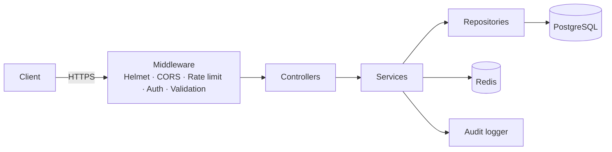
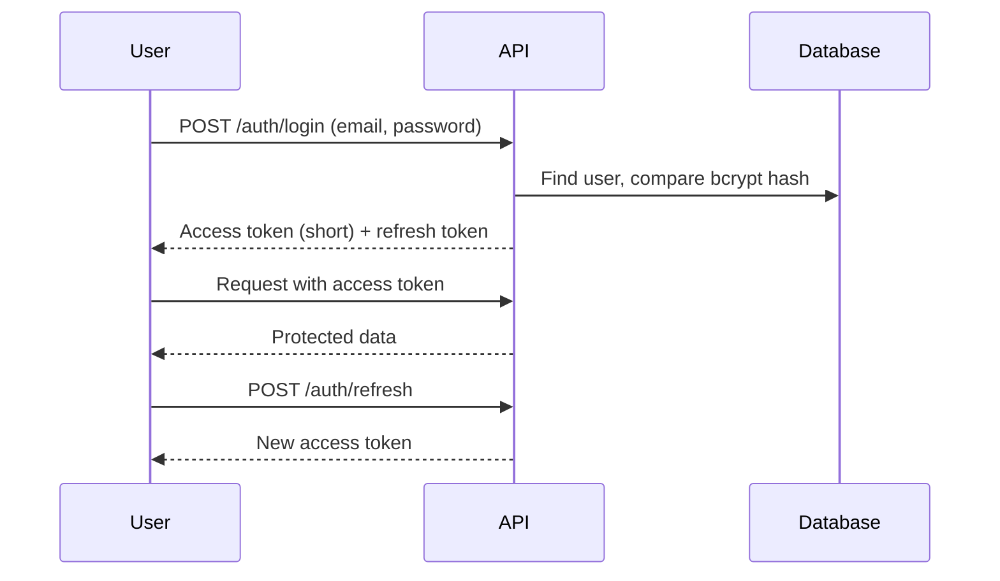
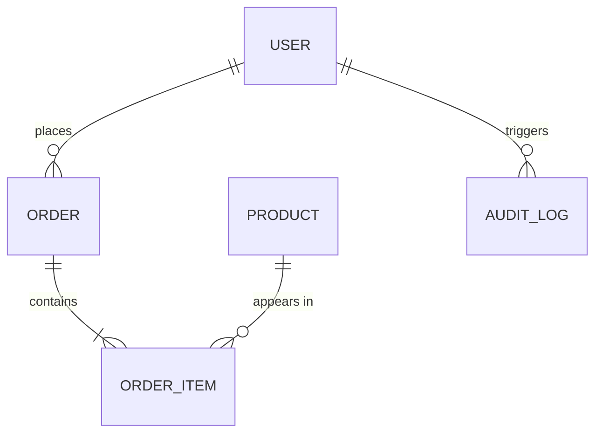

# <div align="center">

# 🛡️ Secure E-Commerce API

**Backend engineering with an attacker's mindset.**
A production-style Node.js API built in public over 16 weeks, where every feature ships with the attack it defends against.


[](https://github.com/YOUR-USERNAME/secure-ecommerce-api/actions)

[Live API](#-live-demo) · [Architecture](#-architecture) · [Security](#-security-by-design) · [API Reference](#-api-reference) · [Build Log](#-build-log) · [PortSwigger Write-ups](https://github.com/YOUR-USERNAME/portswigger-writeups)

</div>

---

## 👋 Why this project exists

I'm **Dina Jendeya**, a software engineer focused on **backend development, cybersecurity and network administration**.
Most tutorials teach you to build an API and bolt security on later. I'm doing the opposite: for 16 weeks I build one API
and, alongside it, break similar systems on [PortSwigger Web Security Academy](https://portswigger.net/web-security).
Every vulnerability I learn to exploit becomes a defense, a test and a write-up in this repo.

> **The rule:** no feature is "done" until I can explain how it would be attacked and show the test that proves it isn't vulnerable.

## ✨ What it does

- 👤 **Users** with registration, login, refresh and logout
- 🛍️ **Products** with admin-managed catalog
- 🛒 **Cart and orders** with server-side price calculation
- 🔐 **Authentication and authorization** (JWT, role-based access control)
- 🧑‍💼 **Admin dashboard APIs**
- 📜 **Audit logs** for sensitive actions
- 🚦 **Rate limiting** and hardened HTTP headers

## 🧰 Tech stack

| Layer | Choice | Why |
|---|---|---|
| Language | TypeScript (strict) | Catch whole classes of bugs before runtime |
| Runtime / framework | Node.js + Express | Simple, explicit middleware pipeline |
| Database | PostgreSQL + Prisma ORM | Relational integrity, typed queries, safe by default |
| Auth | JWT (access + refresh) + bcrypt | Stateless access, revocable refresh |
| Cache | Redis *(from Week 9)* | Fast reads, token revocation |
| Validation | Zod | One schema per request, unknown fields rejected |
| Testing | Jest + Supertest | Includes security regression tests |
| DevOps | Docker, GitHub Actions | One-command start, tested on every push |

## 🏗️ Architecture

> 🚧 *Finalised in Week 4.*



**Layers**

| Layer | Responsibility |
|---|---|
| `routes/` | Map URLs to controllers |
| `middleware/` | Security, auth, validation, error handling |
| `controllers/` | HTTP in, HTTP out. No business logic |
| `services/` | Business rules (prices, stock, permissions) |
| `repositories/` | The only place that talks to the database |

```
src/
├── controllers/
├── routes/
├── services/
├── repositories/
├── middleware/
└── ...
```

## 🔐 Security by design

Each row links an attack I practised in the Academy to the defense in this codebase.

| Threat | Defense in this project | Practised in | Status |
|---|---|---|---|
| SQL injection | Prisma + parameterized queries only | SQL injection labs | ⬜ Week 2 |
| Broken authentication | bcrypt, identical login errors, lockout and rate limits | Authentication labs | ⬜ Week 4 |
| Broken access control / IDOR | RBAC middleware + ownership checks | Access control labs | ⬜ Week 5, 14 |
| Bad input / mass assignment | Zod strict schemas | Access control labs | ⬜ Week 6 |
| CSRF | Token-in-header design, documented reasoning | CSRF labs | ⬜ Week 7 |
| XSS | JSON-only responses, Helmet headers, output encoding | XSS labs | ⬜ Week 8 |
| JWT attacks | Pinned algorithm, strong secret, short expiry | JWT labs | ⬜ Week 9 |
| SSRF | No user-controlled outbound requests | SSRF labs | ⬜ Week 10 |
| Unsafe file upload | *(decision documented if uploads are added)* | File upload labs | ⬜ Week 11 |
| Business logic flaws | Prices and totals computed server-side only | Logic flaw labs | ⬜ Week 12 |
| Race conditions | Database transactions on stock and orders | Race condition labs | ⬜ Week 13 |

### Authentication flow

> 🚧 *Finalised in Week 4.*



### Roles and permissions (RBAC)

> 🚧 *fill in during Week 5, before writing the middleware.*

| Endpoint | Public | User | Employee | Admin |
|---|:---:|:---:|:---:|:---:|
| `POST /auth/register`, `POST /auth/login` | ✅ | ✅ | ✅ | ✅ |
| `GET /products` | ✅ | ✅ | ✅ | ✅ |
| `POST /products`, `DELETE /products/:id` | ❌ | ❌ | TBD | ✅ |
| `POST /orders` | ❌ | ✅ | TBD | ✅ |
| `GET /orders/:id` | ❌ | Own only | TBD | ✅ |


## 🗄️ Database design

> 🚧 *ERD finalised in Week 16.*



## 🚀 Getting started

**Prerequisites:** Docker and Docker Compose. (Node.js 20+ if you want to run without Docker.)

```bash
git clone https://github.com/YOUR-USERNAME/secure-ecommerce-api.git
cd secure-ecommerce-api
cp .env.example .env      # fill in your own secrets, never commit real ones
docker compose up
```

The API will be available at `http://localhost:3000`.


### Useful commands

```bash
npm run dev          # start in watch mode
npm test             # run the Jest + Supertest suite
npx prisma migrate dev
```

## 📚 API reference

> 🚧 *Grows every week. A Postman collection lives in [`/docs`](./docs).*

| Method | Endpoint | Auth | Description | Since |
|---|---|---|---|---|
| GET | `/products` | Public | List products | v0.1.0 |
| POST | `/products` | Admin | Create a product | v0.1.0 |
| DELETE | `/products/:id` | Admin | Delete a product | v0.1.0 |
| POST | `/auth/register` | Public | Create an account | v0.2.0 |
| POST | `/auth/login` | Public | Get access and refresh tokens | v0.2.0 |
| POST | `/auth/refresh` | Refresh token | Rotate the access token | v0.2.0 |
| POST | `/auth/logout` | User | Invalidate the refresh token | v0.2.0 |
| POST | `/orders` | User | Place an order | v0.3.0 |

## 🧪 Testing

- Unit and integration tests with Jest and Supertest
- **Security regression tests:** every vulnerability I find in my own API gets a test that fails if it ever comes back
- CI runs the full suite on every push

## 🌐 Live demo

> 🚧 *Deployed in Week 15.*

- **Base URL:** ``
- **Walkthrough video:** ``

## 🗺️ Build log

Built in public in 8 two-week sprints. Each sprint ends with a demo video and a tagged release.

| Sprint | Weeks | Focus | Release | Status |
|---|---|---|---|---|
| 1 | 1–2 | Foundation: TypeScript, Express, PostgreSQL | v0.1.0 | 🚧 In progress |
| 2 | 3–4 | Prisma and authentication | v0.2.0 | ⬜ |
| 3 | 5–6 | Access control and validation | v0.3.0 | ⬜ |
| 4 | 7–8 | Hardening and Docker | v0.4.0 | ⬜ |
| 5 | 9–10 | Redis and testing | v0.5.0 | ⬜ |
| 6 | 11–12 | Audit logs and refactor | v0.6.0 | ⬜ |
| 7 | 13–14 | CI/CD and API security review | v0.9.0 | ⬜ |
| 8 | 15–16 | Deploy and polish | v1.0.0 | ⬜ |

### Weekly progress log

<!-- Add 1–2 lines every Friday. Newest on top. -->

- **Week 1:** *what I built, what broke, what I learned*

## 🧠 What I'm learning from this

- 📝 [PortSwigger write-ups](https://github.com/dinajendeya/portswigger-writeups): one per vulnerability category, each linked to a fix in this repo
- 🔖 [Release notes](https://github.com/dinajendeya/secure-ecommerce-api/releases): what changed and which attack it defends against

## 🤝 Contributing

This is a learning project, but feedback is very welcome, especially security feedback.
Found a weakness? Please open an issue describing it. See [`SECURITY.md`](./SECURITY.md) for how to report anything sensitive.

## 👩‍💻 About the author

**Dina Jendeya**: software engineer focused on **backend development, cybersecurity and network administration**.
I build APIs, then try to break them, because that's the fastest way to learn how to defend them.

[LinkedIn](https://www.linkedin.com/in/dina-jendeya-255207256) · [GitHub](https://github.com/dinajendeya) · [Email](mailto:dinayaseer@gmail.com)

## 📄 License

[MIT](./LICENSE)
